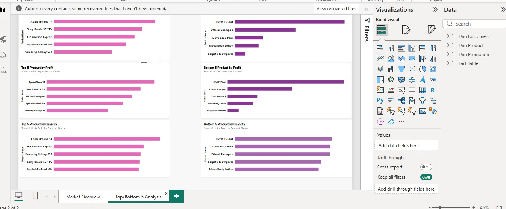
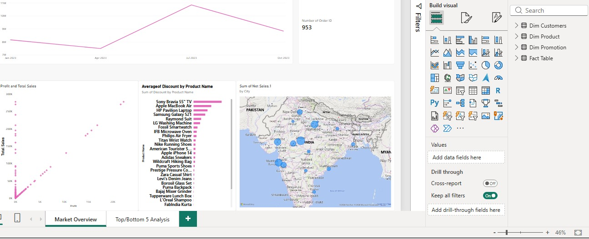

# DAC BUSINESS DATA
---
## PROJECT OVERVIEW
An excel file with four main tables that form a relationalstar-schema
- Dim Customer
- Dim Product
- Dim Promotion
- Sheet 3 (Sales fact table)
## BUSINESS QUESTION ANSWERED
- Top/Bottom Performers: Show top 5 and bottom 5 products byb sales, profit and quantity sold
- sales Trends: How do sales trends vary over time (daily, monthly, quarterly and annually)
- Sales vs Profit: Show the relationship between sales and profit
- Period Comparison: Compare Sales, Profit and Quantity sold between any two periods selected by the user
- Discount Analysis: What is the average discount in each discount category
- Order Volume: What is the total number of orders
- Detailed Order Matrix: Show sales, profit, discount, net sales, and all remaining fields for each order, filterable using visual slicers(Product, Date, Customer ID, and Promotion Categories)
- Geographic Performance: Show total sales broken down by different cities.
## TOOL USED
- Power BI
---
## DASHBOARD PREVIEW

---
## FILES IN THIS REPOSITORY
- [DAC BUSINESS Data](Store+Data.xlsx)
- [DAC BUSINESS DATA](Top_bottom_5_analysis_screenshot.jpg)
- [DAC BUSINESS DATA](market_overview.jpg)
- README.md
  ---
  ## CONCLUSION
  This project helps the company identify how sales trends vary over time and also shows the relationship between sales made and profit. The company would also be able to indentify the top/bottom 5 performers by sales, profit, and quantity sold.
